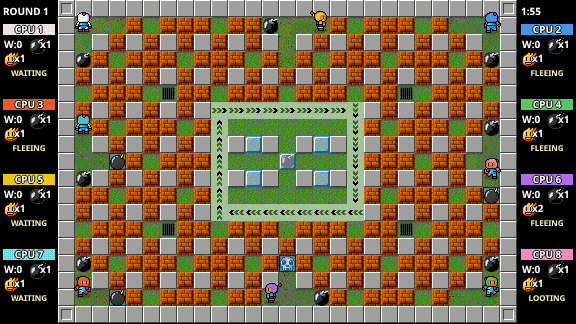
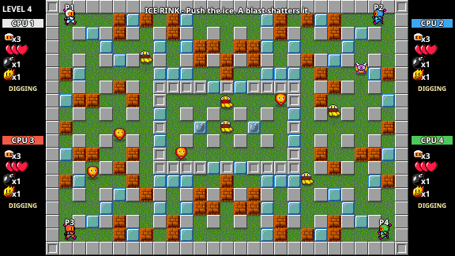
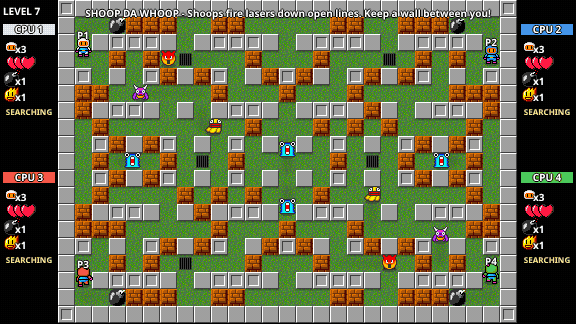
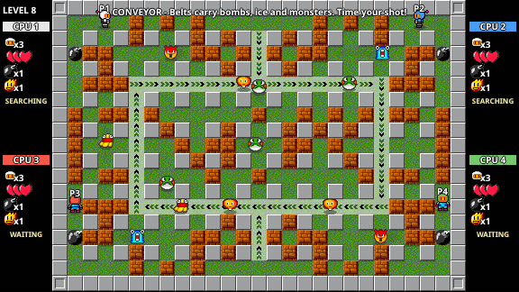
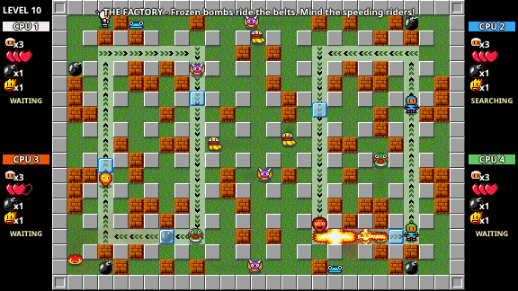
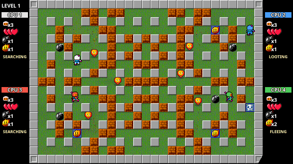
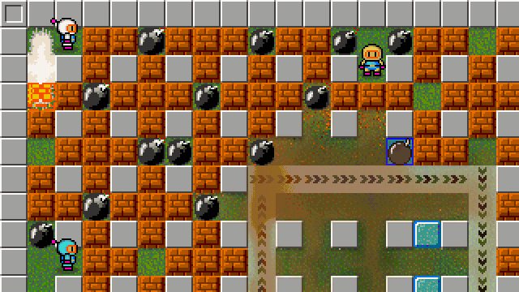
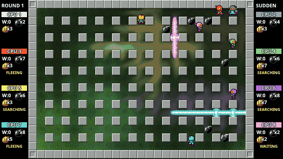

# PiN'a'Blaster

A Dyna Blaster style HTML5 game: a 12-level campaign that brings in one idea at a time (enemies, ice blocks, frozen-bomb fuses, drains, magic carpets, keys and doors) and then mixes them all, plus a Battle mode. 1-8 players on one screen, keyboard and gamepads (CPU players fill the free seats). Every player gets a different colour.

<p align="center"></p>

Plain JavaScript and a canvas: no dependencies and no build step. A small Python server handles LAN play.

## Features

- **12-level campaign**: 7 enemy kinds, ice blocks, frozen bombs, drains, conveyor belts, lasers, keys and doors. Each level adds one new idea, and the last ones combine them.
- **Battle mode**: 6 arenas, first to 3 round wins. After 2 minutes the arena starts closing in.
- **Demo mode**: 8 CPU players fight on their own, and you can join in with the mouse.
- **1-8 players on one screen**: two keyboards, up to four gamepads, touch controls and mouse-driven menus.
- **CPU players** (Easy / Normal / Hard): they read the whole map, team up in the campaign, kick bombs, set traps, and show what they are doing under their stats.
- **LAN multiplayer**: one Python script, no install. Hotseat and network seats can be mixed.
- **Power-ups and curses**: more bombs, more fire, hearts, extra lives, bomb kicking, and the skull curse.
- **Wind effects**: blasts stir a Navier-Stokes fluid that carries smoke, glow and brick fragments through the corridors.

The mechanics are explained in detail in [DETAILS.md](DETAILS.md).

### Campaign

Every level opens with its name and a hint, and CPU teammates help clear it.

| | |
|---|---|
|  |  |
| **Ice Rink**: push ice blocks and crack an ice-gated pen. | **Shoop da Whoop**: snipers fire lasers down open lines. |
|  |  |
| **Conveyor**: a belt loop carries bombs and monsters. | **The Factory**: frozen bombs ride twin belts. |

When the last enemy dies, a black circle closes on the first player, and the next level opens behind it:

<p align="center"></p>

### Explosions and wind

Blasts set off other bombs and break bricks into fragments. Hidden power-ups are uncovered, and smoke drifts through the gaps (shown at 2× zoom):

<p align="center"></p>

### Sudden death

In Battle, the arena starts closing in from the edges after 2 minutes and crushes anyone caught in it. The CPU players see it coming and fall back towards the middle:

<p align="center"></p>

## Run

The game loads its sounds with `fetch`, so open it through a web server, not from `file://`. `server.py` serves the game files (with browser caching turned off, handy while developing) and also hosts LAN multiplayer rooms:

```bash
python server.py --port 8000
```

then browse to <http://localhost:8000/>. (`python -m http.server 8000` works too.)

## Controls

| | Move | Bomb | Menu |
|---|---|---|---|
| Player 1 (keyboard) | Arrow keys | Space | Enter = start / confirm, Esc = back / pause |
| Player 2 (keyboard) | W A S D | Left Shift | |
| Gamepad (any, up to 4 pads) | D-pad or left stick | A or X | Start = start / pause, B or Select = back |

**Touch (phones / tablets):** an on-screen d-pad, a BOMB button, `II` (start / pause) and `BACK` appear automatically on touch devices. Options -> *Touch controls* can force them `On` or `Off` (default `Auto`). Landscape works best. The touch controls join the lobby like any other device (tap BOMB to join, `II` to begin).

**Mouse:** every menu works with the mouse as well: point at an entry to select it, left-click to confirm it (on a volume, the left / right half of the entry lowers / raises it), right-click to go back (during a game a right click pauses, like Esc). In the lobby and the LAN room, click a seat to add a CPU player (on a CPU seat the left / right half makes it easier / harder), and use the Start button at the bottom (right-click leaves the lobby or the room).

`F` toggles fullscreen (so does the button at the bottom-right of the page). `M` mutes / unmutes all sound. In the lobby (a list of eight seats) each player presses Fire on their device to join; Start begins the game. Battle needs 2+ players (CPU players count). A game can also be played by CPU players alone, to watch: add only CPU players and press Start (Enter) on any device (a campaign needs one CPU player, a battle two); Esc / Start still pauses. On a LAN the host can do the same from a room that only has CPU seats.

**CPU players:** in the lobby move the highlight with Up / Down and press Left / Right on the free row to add a computer player. On a CPU row Left / Right switches Easy / Normal / Hard; Left on Easy removes it. What they can do and how they plan: see [CPU players](DETAILS.md#cpu-players).

## Playing on a LAN (office network)

Start the server on one machine and let everybody open its address:

```bash
python server.py
```

It prints something like `http://192.168.1.20:8000/` - share that with your coworkers. (If they cannot connect, allow Python through the Windows firewall for *private* networks. `python server.py --host 127.0.0.1` keeps it local to your machine.)

1. On the title screen choose **Play on LAN**. One person picks **Host a game**, everybody else picks **Join a game** and chooses the room.
2. In the room, every player presses **Fire** on the device they want to play with (keyboard 1, keyboard 2, gamepad, touch controls). One browser can take several seats, so hotseat and LAN combine freely - **8 players in total** (for example two keyboards plus four gamepads and two CPU players on one PC).
3. The host moves a highlight with Up / Down: on the mode row Left / Right switches Campaign / Battle, on a seat row it adds / changes / removes a CPU player (only the host can add CPU players; they run in the host's browser). The host starts the game with Start (Enter / `II`). `Esc` / B on a seat you already took releases it; on a free device it leaves the room.

How it works: the host's browser runs the game and the server only relays messages, so **the host must keep their browser open**. A LAN game cannot be paused (Esc opens a menu while the game keeps running). If a guest leaves, their player dies; if the host leaves, the room closes. Result screens are controlled by the host, who can send everybody back to the room lobby. Joining is only possible while a room is in its lobby.

The server is meant for a trusted network: there are no passwords. It serves only the game files (never `.py` files or the `docs` / `tests` folders).

## Modes

- **Campaign** - 1-8 players, shared keys and doors, 12 levels from *First Steps* to *Final Blast*. Each level opens with its name and a hint.
- **Battle** - last player standing wins a round, first to 3 round wins takes the match. Six arenas: *Classic*, *Open Field*, *Carousel*, *Ice Rink*, *Conveyor* and *Sewers*. After 2 minutes the arena closes in.
- **Demo** - eight CPU players battle on their own until you quit. Click to drop bombs, set them off and bring players back.

All twelve levels, the arenas, bomb kicking, the skull curse and the wind effects are described in [DETAILS.md](DETAILS.md).

## Options

Master / effects / music volume, integer scaling (crisp pixels at whole-number zoom), touch controls (Auto / On / Off) and fullscreen. Settings are remembered in `localStorage`.

## Developer notes

- `?debug` enables debug hotkeys (offline games only): `E` edit mode (freezes entities), `D` danger overlay, `1`-`9` jump to a level, `PageUp` / `PageDown` or `-` / `+` previous / next campaign level, `R` revive player 1, `*` revive every human player or refill their hearts. `?debug&players=N` skips the title and starts a campaign with N players.
- Simulation mode for AI work: `?sim` fast-forwards the game (no sound, a frame drawn every 60 steps; `Engine.SetTurbo(false)` in the console returns to real time). `Sim.Run({ mode, level, roster, seconds, seed, immortal, single })` in the console plays a seeded, repeatable game at full speed and returns kills, hits by cause, round winners and AI decision counts; `Sim.Batch([...])` and `Sim.Summary(results)` run and total many. Example: `Sim.Summary(await Sim.Batch([1, 2, 3, 4].map(seed => ({ mode: "campaign", level: 3, roster: ["kb0", "ai:normal", "ai:hard"], seconds: 40, seed, immortal: true }))))`.
- Every CPU player plans in a worker thread of its own (`Game/AiWorker.js`, driven by `AiController`; the same split as the fluid worker): the controller sends the tile view, keeps walking its old path until the plan comes back (about a millisecond later), drops an answer that no longer fits where the bot now is, and plans on the main thread when workers are unavailable, in turbo (`?sim`, `Sim.Run`, so seeded runs stay repeatable), or if a worker fails or takes over half a second. Workers are stopped when the game is left.
- Headless AI bench (Node, all cores, no browser): `node tests/aibench.js battle [seeds] [level] [seconds]` plays seeded 4-bot battles on every arena, the current AI (`Game/`) against a frozen copy of an older one (`tests/ai_baseline/`), with the seats swapped as well, and prints wins, deaths by cause, kills, kicks and jitter (direction reversals and A-B-A-B tile flip-flops per minute). `duel` and `campaign` modes too; the environment variables are listed at the top of the file (`BASE_DIR` / `AI_SET` test a tuning change head to head). `tests/headless.js` is the headless game it uses, with test arenas for single skills (`LAB=kick|drain|maze`, and `GIVE='{"PushableBombsTime":1e9,"Power":3}'` to hand every bot a loadout), e.g. `LAB=kick GIVE=... node tests/aibench.js battle 12 hard 240`; `ALLNEW=1` fills every seat with the new AI. `COOP=normal node tests/aibench.js campaign 14 hard 200` plays the campaign with the human seat played by the original AI at that level (a stand-in for a person who moves about) and reports who hurt whom (enemies, own bombs, friendly fire) and the clear time.
- Campaign maps live in `Game/Levels.js` (tile legend at the top). `LevelProblems` checks a level can be finished (every enemy and key reachable or drain-reachable, doors have keys, every spawn can survive its first bomb); `tests/levels.test.js` runs it on every level for 1-8 players and checks the difficulty never drops. Add `single: true` to a `Sim.Run` to stop when the first level is cleared.
- Tests (no dependencies): `node --test tests/*.test.js` (Node 22) and `python -m unittest discover -s server_tests`
- `server.py` + `lan/` is the Python side (static files, WebSocket codec, rooms). `Net/` and `Game/NetGame.js`, `Game/Lan.js` are the browser side. See `docs/superpowers/specs/2026-10-01-lan-multiplayer-design.md`.
- The game runs on a fixed 10 ms simulation step inside `requestAnimationFrame`; the virtual canvas is 576x324 and is scaled to the window by CSS.
- `Library/jQuery.js` is no longer used or loaded.
